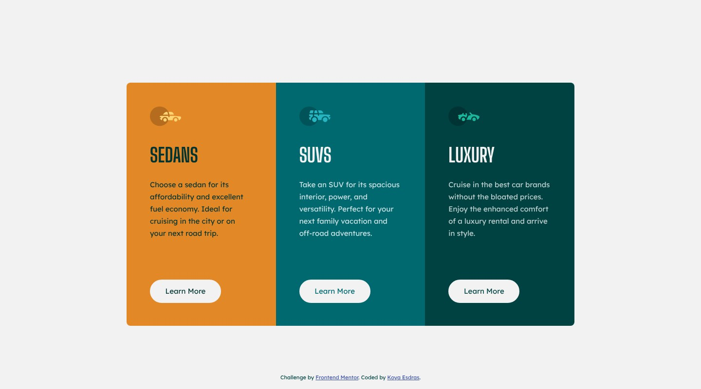

# Frontend Mentor - 3-column preview card component solution

This is a solution to the [3-column preview card component challenge on Frontend Mentor](https://www.frontendmentor.io/challenges/3column-preview-card-component-pH92eAR2-). Frontend Mentor challenges help you improve your coding skills by building realistic projects.

## Table of contents

- [Overview](#overview)
  - [Screenshot](#screenshot)
  - [Links](#links)
- [My process](#my-process)
  - [Built with](#built-with)
  - [Workflow](#workflow)
  - [What I learned](#what-i-learned)
  - [Continued development](#continued-development)
  - [Useful resources](#useful-resources)
  - [AI Collaboration](#ai-collaboration)
- [Author](#author)

## Overview

### Screenshot



### Links

- Solution URL: [frontendmentor.io/solutions/3column-preview-card-component-yqth3VC8P6](https://www.frontendmentor.io/solutions/3column-preview-card-component-yqth3VC8P6)
- Live Site URL: [ounokoya.github.io/front-3-column-preview-card](https://ounokoya.github.io/front-3-column-preview-card/)

## My process

### Built with

- Semantic HTML5: a visually hidden `h1`, three `article` elements each with an `h2`, decorative icons, and three "Learn More" links with distinct names for screen readers ("Learn More about sedans")
- WCAG AA colours: the design's light text on the gold card is 2.13 to 2.41:1, so that card uses a very dark green (5.13:1); the SUVs paragraph is white at 80 % instead of 75 % (4.76:1)
- [Tailwind CSS v4](https://tailwindcss.com/) — design tokens in `@theme`, default palette removed, named `learn` and `link` utilities
- Big Shoulders Display and Lexend Deca served with the site through [Fontsource](https://fontsource.org/)
- Mobile-first: stacked cards below 1024 px, three columns from 1024 px with the links aligned at the bottom
- [Vite](https://vite.dev/) for the build, deployed on GitHub Pages from the `gh-pages` branch (`npm run deploy`)
- [Playwright](https://playwright.dev/), [axe-core](https://github.com/dequelabs/axe-core), the W3C Nu validator, html-validate and ESLint for tests

### Workflow

This is version 2 of my 2023 solution, rebuilt from the current starter in the same repository. Before any code, the design was analysed and rebuilt:

1. **Visual analysis in Excalidraw** — measurements in px, contrast checks, the HTML tree → [`specs/visuel/`](./specs/visuel/)
2. **Penpot mockup** — library, desktop, mobile and tablet screens, visual thresholds calibrated against the design JPGs → [`specs/visuel/penpot/`](./specs/visuel/penpot/)
3. **Spec, then tests** — 20 Given/When/Then scenarios and the accessible names the tests rely on → [`specs/specifications/`](./specs/specifications/); the tests were written before the code and checked to fail on the starter
4. **Decisions** — tokens and AA colours, fonts, the links and their states, the layout → [`specs/adr/`](./specs/adr/)
5. **Code**, then a walk-through in a real browser → [`specs/analyse/`](./specs/analyse/)

### What I learned

**The heading font is not the one in the style guide.** The design uses Big Shoulders **Display**; the "Big Shoulders" family that Google now serves is 13 % wider at 40 px, so "SEDANS" would not match. The site loads `@fontsource/big-shoulders-display`.

**One hover colour per card, without three rules.** Each card sets a custom property, and the link uses it for its hover and focus:

```html
<article class="[--ink:var(--color-green-aa)] ...">
  <a class="learn" href="#">Learn More<span class="sr-only"> about sedans</span></a>
</article>
```

**Line breaks decide the paragraph width.** The design's lines fit only between 208.1 and 212.1 px; a 920 px row of three columns with 48 px padding gives 210.7 px, so every line breaks where the design breaks it.

### Continued development

- **Visual comparison with the design files.** Screenshots differ from the Frontend Mentor JPGs by 1.96 % (desktop), 2.92 % (hover state) and 3.68 % (mobile) of pixels; most of the difference is the dark text on the gold card, my accessibility choice.
- **Tablet**: my own proposal, the stacked cards centred below 1024 px.

### Useful resources

- [WebAIM — Contrast checker](https://webaim.org/resources/contrastchecker/) — the gold card's text.
- [W3C WAI — Link purpose](https://www.w3.org/WAI/WCAG22/Understanding/link-purpose-in-context.html) — why each "Learn More" needs a distinct name.
- [Fontsource — Big Shoulders Display](https://fontsource.org/fonts/big-shoulders-display) — the font of the design files.

### AI Collaboration

I used **Claude (Claude Code)** as a pair, inside my own spec-driven workflow where I validated each step before the next one:

- **Planning**: Claude listed my old solutions that needed a rebuild and wrote the plan, which I validated.
- **Design analysis and mockup**: Claude measured the JPG designs, drew the annotated Excalidraw analysis and built the Penpot mockup; I reviewed both and decided on the AA colours, the link names, the hidden page heading, the decorative icons, the tablet layout and the heading font.
- **Spec and tests**: written by Claude before any code, from the validated mockup.
- **Technical decisions**: fonts from Fontsource, as in my earlier solutions without font files in the starter.
- **Code**: written by Claude from the spec — I confirmed this split at the code lock — with the tests run at each step.

What worked well: comparing the page with the design pixel by pixel explained every difference before it was fixed. What needed my decisions: the choices listed above.

## Author

- Frontend Mentor - [@ounokoya](https://www.frontendmentor.io/profile/ounokoya)
- GitHub - [@ounokoya](https://github.com/ounokoya)
